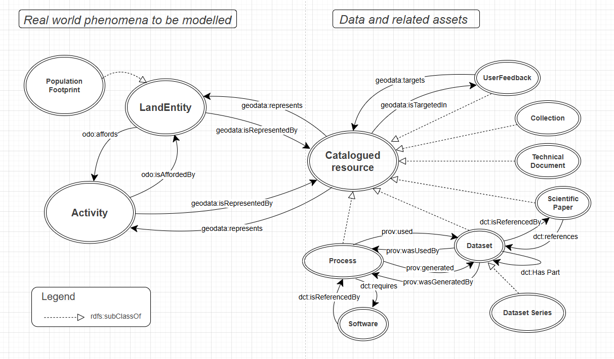

# Outdoor Pressure Knowledge Graph

Outdoor Pressure Knowledge Graph (KG) encodes into a graph model different information needed to discover and reuse data to study the impact of recreational activities in the French Alps. It reuses classes and properties from the more generic [Geodata Knowledge Graph](https://github.com/umrlastig/geodata) and introduces new elements to represent more specific data sources or processes as well as real-world phenomena that are studied through data.

See [Documentation](https://intforout.github.io/outdoorPressure/index.html) for more information.

<figure>
  
  <figcaption><em>figure 1: Overview of classes and properties that structure ODO</em></figcaption>
</figure>

Design is **task-driven**. Nodes and edges are gradually created to support specific tasks within [INTFOROUT project](https://www.umr-lastig.fr/intforout/). These tasks are then showcased through predefined queries in a dedicated software companion. See [Sham-Wah application](https://github.com/intForOut/sham-wah)

You are welcome to **contribute** through issues or direct pull request on the rdf file:
- create a UserFeedback to share your own expertise, experience, or observations about data, software, or papers you read.
- create a Dataset to describe data that is relevant to the scope. A dataset is "a coherent collection of information or resources (data files, explanatory files, APIs, links, etc.) and metadata (description, publication date, keywords, geographical/temporal coverage, etc.)."
- create a Blank issue for everything else of if you are not sure about the categories of instance you wish to insert.
Please, follow the [guides](guides/readme.md) in your contributions.

This work is supported by the ANR research project IntForOut: Multisource spatial data INTegration FOR the Monitoring of Ecosystems under the pressure of OUTdoor recreation (ANR-23-CE55-0003).
